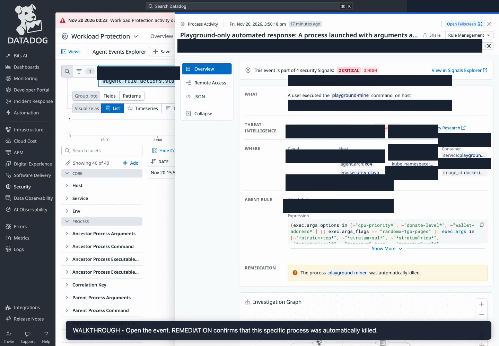

# Install the Datadog Security Playground and demonstrate automated response in EU1

This guide deploys the upstream Datadog Security Playground and adds three narrowly scoped process-termination rules: cryptominer arguments, BPFDoor socket-filter activity, and mining-pool connections. A fourth rule tracks the BPFDoor PID-file marker. Every blocking rule requires the exact playground container ID in its expression before its kill action can run.

This repository contains the companion rules and scripts; these additions are not part of the upstream DataDog repository. No credentials, source-environment container IDs, or existing Datadog rule IDs are included. The original demo was verified on standard GKE with Agent 7.81.1. This kit has passed offline rendering and scope checks; it has not been deployed into your EU1 organization.

| EU1 setting | Value |
| --- | --- |
| Browser UI | https://app.datadoghq.eu |
| Agent site / DD_SITE | datadoghq.eu |
| API base URL | https://api.datadoghq.eu |

An image registry domain is separate from the telemetry destination. This chart can pull the Agent from registry.datadoghq.com while sending telemetry to EU1 through the site setting. Datadog sites and keys are independent. [Datadog sites](https://docs.datadoghq.com/getting_started/site/)

## Video walkthrough

[](docs/media/automated-blocking-walkthrough.mp4)

[Watch or download the captioned MP4](docs/media/automated-blocking-walkthrough.mp4). The recording shows Agent rule settings, a security signal, automatic remediation, and the performed kill action JSON. Account and infrastructure identifiers are redacted. The recording was captured in a US1 demonstration organization; follow the EU1 links and settings in this guide for your own deployment.

## 1 Prepare the account and cluster

In your own EU1 organization, enable Workload Protection from Security → Workload Protection → Get Started. Use your organization's EU1 API key. Creating the demo detection rule also requires an application key with security_monitoring_rules_write. The scripts prompt for keys without echoing them and do not save them to files. Only the API key is placed in a Kubernetes Secret for the Agent; the application key is never mounted into a pod.

For UI-managed response actions, the administrator must grant security_monitoring_cws_agent_rules_actions to the appropriate users. [Setup requirements](https://docs.datadoghq.com/security/workload_protection/setup/) · [Response permissions](https://docs.datadoghq.com/security/workload_protection/respond_and_report/)

Use a nonproduction Kubernetes environment and a standard Linux amd64 node where privileged Agent containers, host mounts, eBPF, and the simulator's raw socket are permitted. This recipe does not cover GKE Autopilot, Fargate, Windows, or ARM64. Check the supported kernel and distribution matrix first. Allow capacity for the demo application and Agent; their configured memory limits total about 2.2 GiB. The application is intentionally vulnerable, so this guide creates no public Service or Ingress.

On the workstation, install Git, kubectl, Helm, and Python 3.9 or newer. No additional Python packages are needed. The workstation needs access to GitHub, the Helm repository, the EU1 API, and the Kubernetes API. The node needs its image registries and Datadog EU1 intake; the optional mining-pool test also needs public DNS and a TCP connection attempt to donate.v2.xmrig.com:3333.

```bash
kubectl config get-contexts
kubectl --context YOUR_CONTEXT get nodes -o wide
```

Choose one deployment path:

- **Path A:** the chosen node has no existing Datadog system-probe or security-agent. Install a separate demo Agent on that node using steps 3–9. An existing core/trace Agent can remain in place.
- **Path B:** Workload Protection is already active on the chosen node. Reuse that Agent using the integration section below. Do not run the Path A installer on top of an existing probe.

If an existing Agent has a system-probe but Workload Protection/enforcement is not enabled, have its platform owner configure a scoped rollout or use a separate test cluster. The kit does not enable enforcement across an existing cluster-wide release.

## 2 Clone this guide and the upstream playground

Clone both repositories into the same parent directory, then pin the source revision used for the demonstrated binaries:

```bash
git clone https://github.com/jon94/datadog-security-playground-eu1.git
git clone https://github.com/DataDog/datadog-security-playground.git
git -C datadog-security-playground checkout --detach 32b896ac15c9414678b3d6bfa6ddbd3cbc31f16f
cd datadog-security-playground-eu1

export KUBE_CONTEXT='REPLACE_WITH_YOUR_CONTEXT'
export DEMO_NODE='REPLACE_WITH_YOUR_LINUX_AMD64_NODE'
export CLUSTER_NAME='customer-security-demo'
export DD_SITE='datadoghq.eu'
```

Replace the two REPLACE_WITH values before continuing. The node must be schedulable and untainted for this basic recipe. The application image is pinned to the digest verified in the original demo. Use a separate copy of the kit for each cluster or Datadog organization.

For example, a GKE cluster could use the following fictional values:

```bash
export KUBE_CONTEXT='gke_customer-project_europe-west1_security-demo'
export DEMO_NODE='gke-security-demo-default-pool-a1b2c3d4-abcd'
```

`KUBE_CONTEXT` identifies the cluster connection in your kubeconfig. `DEMO_NODE` is the exact Kubernetes node name where the playground will run. Find your own values with:

```bash
# Pick a context from the NAME column, then set KUBE_CONTEXT to that value.
kubectl config get-contexts

# Using your selected context, pick a node with linux and amd64 labels.
kubectl --context "$KUBE_CONTEXT" get nodes \
  -L kubernetes.io/os,kubernetes.io/arch
```

Set `DEMO_NODE` to the selected node's NAME before continuing.

Do not apply the upstream deploy/datadog-agent.yaml unchanged: the inspected revision selects a development Agent image and US1 settings. The companion kit uses the tested release Agent image and EU1 settings instead.

## 3 Install the isolated demo with Path A

```bash
python3 playground.py install \
  --context "$KUBE_CONTEXT" \
  --node "$DEMO_NODE" \
  --cluster-name "$CLUSTER_NAME"
```

Enter your EU1 API key when prompted. The installer validates it against api.datadoghq.eu before creating resources. It then:

1. Checks for a conflicting Datadog probe and unrelated namespaces with the same names.
2. Creates playground and playground-security.
3. Deploys the pinned playground application on the chosen node, without a Kubernetes service-account token or public endpoint.
4. Reads the new container ID and generates the four guarded policy rules.
5. Stores the policy in the playground-security/playground-blocking-policy ConfigMap.
6. Installs the security-playground Helm release, chart 3.231.4, with Agent 7.81.1 on that node only.

The dedicated Agent has enforcement enabled and Remote Configuration disabled. Its rule delivery is through the local ConfigMap. Activity dumps, security profiles, service discovery, and ordinary metric payloads are disabled. Existing Agent releases are not upgraded.

The generated directory contains the rendered settings, policy, deployment state, and later the demo detection-rule ID. It contains no saved Datadog keys. If installation fails after creating resources, inspect the reported error and use step 9 to remove the kit resources if needed.

## 4 Verify readiness and loaded rules

```bash
python3 playground.py status
```

Continue when the application and Agent pods are Ready, Runtime Security reports Connected: true, self-tests pass, and all four rules report loaded:

```text
cws_playground_bpfdoor_marker
cws_playground_block_cryptominer_args
cws_playground_block_bpfdoor_bpf_filter_creation
cws_playground_block_mining_pool_domain_v2
```

If the pods are Pending, inspect node capacity and scheduling events. If the Agent reports kubelet certificate errors, configure the correct trust settings with the platform owner. The installer exposes --insecure-kubelet-tls for an explicitly approved test-cluster exception; certificate verification is enabled by default.

## 5 Create the EU1 detection rule before running a test

```bash
python3 playground.py create-signal-rule
```

Enter your EU1 API key and EU1 application key when prompted. The script creates **[Playground] Workload response observed** in your organization and prints its new rule ID. It matches only the three custom playground Agent rule IDs and sends no notifications.

Save the printed query:

```text
@workflow.rule.id:YOUR_NEW_RULE_ID
```

The detection rule creates a signal when a response is observed, including a queued or unsuccessful attempt. The raw event's action status is the proof of successful termination. Re-running the command uses the locally recorded rule ID instead of creating a duplicate.

## 6 Run the simulations

Start with the miner and BPFDoor simulations:

```bash
python3 playground.py test --repo ../datadog-security-playground --test miner
python3 playground.py test --repo ../datadog-security-playground --test bpfdoor
```

For the miner, the control invocation without mining arguments should remain running until the harness stops it. The invocation with --cpu-priority 4 should return -9, meaning SIGKILL. The BPFDoor simulator daemonizes, so its parent can exit normally: verify its child's performed kill action in Datadog.

To test the third rule:

```bash
python3 playground.py test --repo ../datadog-security-playground --test mining-pool
```

This performs a DNS lookup and TCP connection attempt to donate.v2.xmrig.com:3333, sends no mining protocol data, and waits for termination. Skip it if your approved test plan or egress policy does not permit that destination. No match is expected if DNS or the connection attempt is prevented before the relevant Agent event occurs.

The first match of a rule can enter a safeguard warm-up period, observed at about 60 seconds in the tested Agent. The harness allows for it. Keep the safeguards enabled. A full run is also available with --test all.

These tests execute the repository's demo binaries inside the playground pod. They validate workload response; they do not require running the entire RCE, persistence, or cloud-credential attack chain.

## 7 Validate the result in the EU1 UI

1. Open https://app.datadoghq.eu/security/workload-protection/signals.
2. Search using the new detection-rule ID from step 5. Set the time range to include the test and allow time for ingestion and the one-minute evaluation window.
3. Open a playground signal. Review the process, Kubernetes namespace, pod, container ID, and automatic-remediation message.
4. Open https://app.datadoghq.eu/security/workload-protection/agent-events and use:

```text
@agent.rule_id:cws_playground_block_* @agent.rule_actions.status:performed
```

5. Click the process executable cell to open an event. In Overview, inspect REMEDIATION. In JSON, inspect agent.rule_actions:

```json
{
  "type": "kill",
  "signal": "SIGKILL",
  "scope": "process",
  "status": "performed"
}
```

Also review killed_at, exited_at, and ttr. A signal, kill_queued, or kill_aborted alone does not prove that the Agent terminated the process. The Agent acts at rule-match time; the backend signal appears afterward. Individual remediation timings vary. [Action behavior](https://docs.datadoghq.com/security/workload_protection/detect_and_monitor/agent_rules/variables_and_actions/)

This guide manages the policy as a local file. A remotely managed UI policy is not created or required. Loaded Agent status and event action reports establish what is active. UI policy changes will not control this dedicated Agent while Remote Configuration is disabled.

## 8 Refresh the guard after a pod replacement

An exact container ID deliberately stops matching when that container is replaced. For Path A:

```bash
python3 playground.py refresh-policy
python3 playground.py status
```

The helper reads the current ready pod, updates the policy ConfigMap, and restarts only the dedicated demo Agent DaemonSet to remount it. Allow the response warm-up again. If the chosen Kubernetes node is replaced, select a new node and update the deployment through a fresh, reviewed kit setup.

Optional application access, in a separate terminal:

```bash
kubectl --context "$KUBE_CONTEXT" -n playground \
  port-forward deployment/playground-app 15000:5000 --address 127.0.0.1
```

Open http://127.0.0.1:15000. Stop the port-forward with Ctrl+C when finished.

## 9 Remove the Path A deployment

```bash
python3 playground.py cleanup
```

The helper checks namespace ownership before uninstalling the dedicated release and deleting the kit's two namespaces. It does not uninstall an existing Agent release. Disable or delete the printed demo detection rule in the EU1 UI afterward. Retain the generated state until its rule ID has been recorded; remove generated/ before a fresh installation.

## Integrate with an existing Workload Protection Agent using Path B

Use this path when runtime security and enforcement are already enabled in the existing Agent. Have the platform owner apply changes through Helm, the Datadog Operator, or the existing GitOps source of truth. Do not install a second system-probe on the same node or enable enforcement across an existing fleet merely to run the demo.

### B1 Deploy only the playground application

From a fresh copy of the kit, render manifests without contacting Kubernetes or Datadog:

```bash
python3 playground.py render --existing-agent \
  --node "$DEMO_NODE" --cluster-name "$CLUSTER_NAME"
kubectl --context "$KUBE_CONTEXT" apply -f generated/workloads.json
kubectl --context "$KUBE_CONTEXT" -n playground \
  rollout status deployment/playground-app --timeout=300s
```

Use an unused playground namespace. Inspect the rendered manifest before applying it. The existing-agent render mode does not create playground-security or install an Agent.

### B2 Generate a policy using the customer's container ID

```bash
CONTAINER_ID=$(kubectl --context "$KUBE_CONTEXT" -n playground \
  get pods -l app=playground-app \
  -o jsonpath='{.items[0].status.containerStatuses[0].containerID}')
CONTAINER_ID=${CONTAINER_ID#*://}

python3 playground.py render --existing-agent \
  --context "$KUBE_CONTEXT" --node "$DEMO_NODE" \
  --cluster-name "$CLUSTER_NAME" --container-id "$CONTAINER_ID"
```

The helper requires the complete 64-character ID. It writes generated/playground.policy and a render-state file for the test commands.

### B3 Mount the policy without removing existing policy files

Identify the existing Agent namespace and how its runtime policy ConfigMap is configured. Set DD_AGENT_NAMESPACE to the actual namespace. If a runtime policy ConfigMap is already mounted, preserve it and add cws-playground.policy as a new data key in that same ConfigMap through its owning configuration.

If no custom policy ConfigMap is configured, create a new one:

```bash
export DD_AGENT_NAMESPACE='REPLACE_WITH_EXISTING_AGENT_NAMESPACE'
kubectl --context "$KUBE_CONTEXT" -n "$DD_AGENT_NAMESPACE" \
  create configmap playground-blocking-policy \
  --from-file=cws-playground.policy=generated/playground.policy
```

For an existing Helm-managed installation, the corresponding values addition is:

```yaml
datadog:
  securityAgent:
    runtime:
      policies:
        configMap: playground-blocking-policy
```

Apply this through the existing release's reviewed values and pinned chart version. Do not replace the existing values, secret references, site, runtime settings, or any previously configured policy ConfigMap. A new volume mount requires an Agent rollout; the platform owner should manage that rollout. With Operator/GitOps management, make the equivalent policy mount in its source of truth. [Manual policy deployment](https://docs.datadoghq.com/security/workload_protection/detect_and_monitor/agent_rules/policy_management/)

After ConfigMap updates have appeared in the selected node's Agent, reload that Agent's policies:

```bash
export DD_AGENT_POD='REPLACE_WITH_AGENT_POD_ON_THE_DEMO_NODE'
kubectl --context "$KUBE_CONTEXT" -n "$DD_AGENT_NAMESPACE" \
  exec "$DD_AGENT_POD" -c system-probe -- system-probe runtime policy reload
kubectl --context "$KUBE_CONTEXT" -n "$DD_AGENT_NAMESPACE" \
  exec "$DD_AGENT_POD" -c security-agent -- security-agent status
```

Confirm all four playground rules are loaded before testing. When reusing an existing ConfigMap, add only the new file; do not use a command that replaces its entire data map. If another ConfigMap already has the proposed file name, choose a unique name and preserve the original.

### B4 Create the detection rule and run the same tests

```bash
python3 playground.py create-signal-rule --api-only
python3 playground.py test --repo ../datadog-security-playground --test miner
python3 playground.py test --repo ../datadog-security-playground --test bpfdoor
```

The API-only command prompts for the EU1 keys and records the new rule ID in generated/detection-state.json. The tests use the render-state from B2. The optional mining-pool test and EU1 UI checks are the same as steps 6 and 7.

After a pod replacement, repeat B2, update the policy file through the existing ConfigMap's owner, wait for projection, and reload the selected Agent. For cleanup, remove only cws-playground.policy and the new mount if it was created exclusively for this demo, delete the playground application namespace, and disable the demo detection rule. Do not run Path A cleanup or uninstall the existing Agent.

## Kill action syntax

Add `actions` to the rule that should terminate the matching process. For example:

```yaml
rules:
  - id: SLEEP_KILL
    expression: exec.file.name == "sleep" && "9999" in process.argv
    actions:
      - kill:
          signal: SIGKILL
          scope: process
```

This minimal example matches `sleep` with the argument `9999`. It is illustrative and is not added to the installed playground policy. The three installed blocking rules use the same `actions: - kill:` structure and also require the exact playground container ID in their rule expressions. The BPFDoor marker remains a tracking rule without a kill action.

An action-level `filter` is optional; it is omitted here because the rule expression already defines the intended match and container scope. Adding the kill action to one rule does not add it to other rules in the policy. Agent enforcement must be enabled, and the rule must load successfully for the response to run. [Datadog action syntax and requirements](https://docs.datadoghq.com/security/workload_protection/detect_and_monitor/agent_rules/variables_and_actions/)

The JSON policy template uses the same structure: an `actions` array containing a `kill` object with `signal` and `scope`. Existing hash actions and the BPFDoor tracking dependency are preserved.

## Package contents and verification

The templates preserve the tested rule dependencies and hash actions. The scripts pin Helm chart 3.231.4 and Agent 7.81.1 and restrict automatic termination to process scope. No response actions are added to organization-wide default rules. Review and validate a supported newer release separately before changing those pins.

Run the offline checks with:

```bash
python3 -m unittest test_render.py -v
```

The checks cover EU1 routing, the single-node selector, exact-container kill guards, conflicting-probe detection, and cleanup ownership checks. These checks and the original GKE demo do not establish compatibility with every customer cluster; complete the readiness, self-test, and performed-action checks in your own environment.
